

  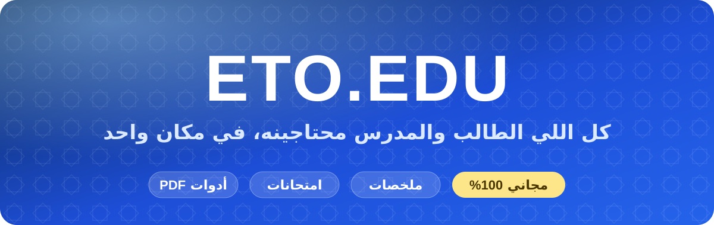

  <b>أدوات PDF. امتحانات أونلاين. ملخصات. جداول مذاكرة. آلة حاسبة علمية. كورسات لغات. ركن ديني. روبوت بيمشي معاك.</b> 
  <b>كله مجاني، وكله على موبايلك.</b>

  
  
  
  
  

<i>صل ع النبي وعيش يا باشا في السايت</i>

---

## 📑 المحتويات

[إيه هو ETO.Edu؟](#-إيه-هو-etoedu) ·
[الصفحة الرئيسية](#-الصفحة-الرئيسية) ·
[للطالب](#-للطالب) ·
[للمعلم](#-للمعلم) ·
[أدوات PDF](#-أدوات-pdf) ·
[أدوات الصوت](#-أدوات-الصوت) ·
[أدوات تعليمية](#-أدوات-تعليمية-تفاعلية) ·
[المواد واللغات](#-المواد-الدراسية-وتعلّم-اللغات) ·
[الركن الديني](#-الركن-الديني) ·
[روبوت إيتو](#-روبوت-إيتو) ·
[التثبيت](#-ثبّت-الموقع-كتطبيق) ·
[الأسئلة الشائعة](#-أسئلة-شائعة) ·
[كل اللينكات](#-كل-اللينكات)

---

## 🌟 إيه هو ETO.Edu؟

موقع بيجمع الأدوات اللي الطالب والمدرس بيدوّروا عليها في عشرين موقع مختلف، ويحطها في مكان واحد، بشكل شيك وسهل، وبالمصري.

عايز تدمج ملفين PDF؟ تعمل جدول مذاكرة؟ تنشر امتحان لطلابك؟ تعرف نسبتك المئوية؟ تسمع ملف PDF بدل ما تقراه؟ كله هتلاقيه هنا، من غير تسجيل ومن غير ما ترفع ملفاتك لأي سيرفر.

| 🧰 50+ أداة | 💸 0 جنيه | 🔓 0 تسجيل للأدوات | 🔒 100% خصوصية |
|:---:|:---:|:---:|:---:|
| في مكان واحد | مجاني بالكامل | افتح واشتغل علطول | الملفات بتتعالج على جهازك |

---

## 🏠 الصفحة الرئيسية

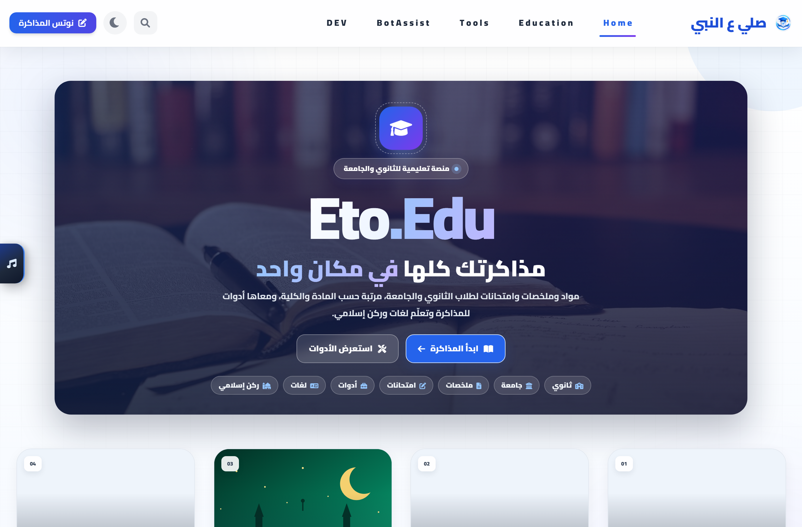

أول ما تفتح الموقع هتلاقي رسالة ترحيب وبطاقات كبيرة، اختار منها اللي محتاجه:

| البطاقة | بتودّيك فين |
|---|---|
| 🎓 **التعليم** | أدوات الطالب والمعلم وملفات PDF والشيتات والامتحانات وتنظيم المذاكرة |
| 🧰 **الأدوات** | أدوات سريعة للتحويل والملفات والتنظيم والحلول اليومية |
| 📚 **المواد الدراسية** | كل كلية ومعهد ليها صفحة، وكل مادة فيها شرح وملفات وملخصات |
| 🌍 **تعلّم اللغات** | اتعلم لغة جديدة خطوة بخطوة |
| 🕌 **الركن الديني** | مواقيت الصلاة وسجل الصلوات اليومي |

وفي أي صفحة هتلاقي **بحث شامل** بيوصّلك لأي أداة بالاسم، وزرار **الوضع الداكن**، وزرار رجوع صغير.

  

---

## 🎒 للطالب

### مدرسيني

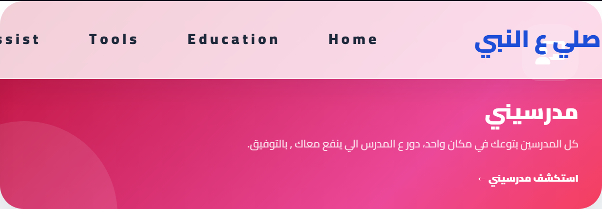

كل المدرسين بتوعك في مكان واحد. دوّر على المدرس، شوف المادة، وادخل على منصته مباشرة.

---

### منصاتي

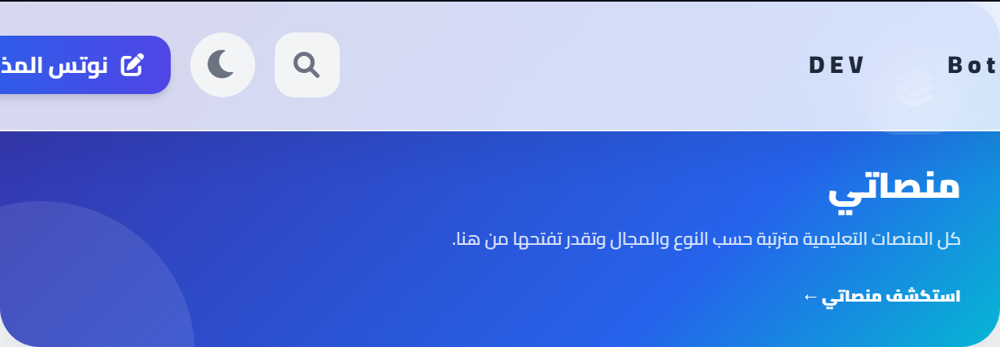

كل المنصات التعليمية مترتبة حسب النوع والمجال، ومعاها بحث وفلاتر. بدل ما تحفظ عشرين لينك، كلها هنا.

---

### ملخصات الطلاب

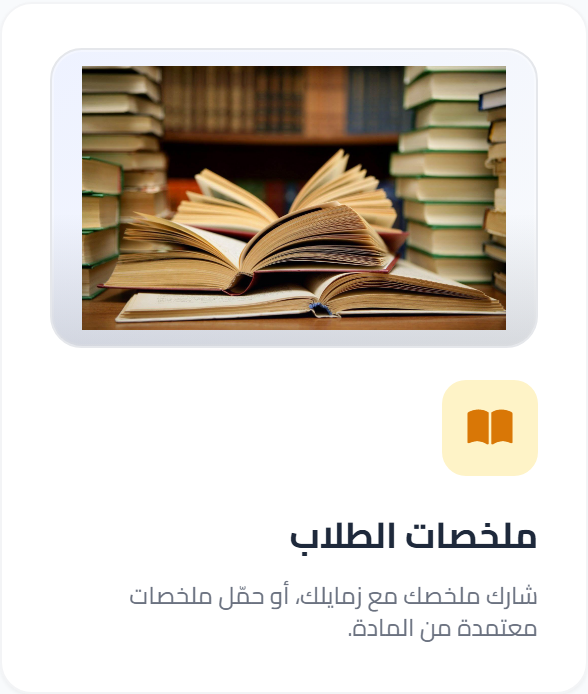

مكتبة ملخصات معتمدة ومترتبة.

- اختار **المرحلة الدراسية** (من أولى ابتدائي لحد تالتة ثانوي والبكالوريا) و**نوع الدراسة** (عام أو لغات).
- **عاين الملخص جوه الموقع** من غير تحميل، وحمّله لو عجبك.
- **قيّم الملف** عشان تفيد طلبة تانيين.
- **عندك ملخص؟** ابعته من الموقع، هيفتحلك واتساب ببياناتك جاهزة، ويتراجع وبعد الموافقة يظهر لكل الطلبة.

---

### بنك الامتحانات

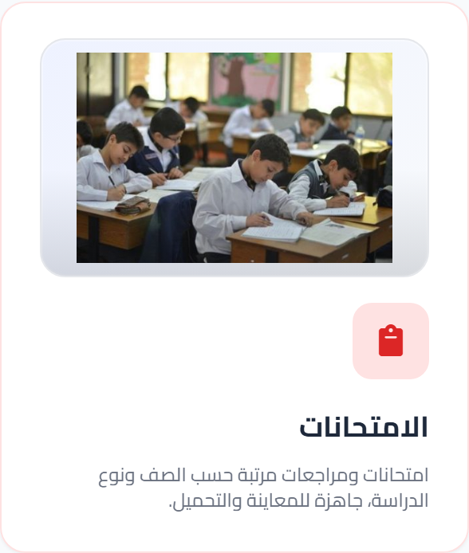

امتحانات ومراجعات مرتبة حسب الصف ونوع الدراسة، جاهزة للمعاينة والتحميل، ومعاها تقييم عشان تعرف أنهي ملف يستاهل.

---

### جدولي

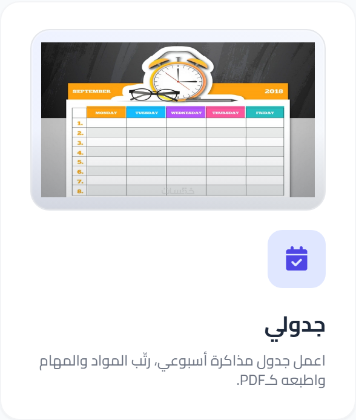

اعمل جدول مذاكرة أسبوعي كامل.

- اكتب المادة والمطلوب في أي خانة بالضغط عليها، وعدّل أسماء الأيام والأوقات.
- اختار لون الجدول، وحط **هدفك الأسبوعي** وعدد ساعات المذاكرة.
- حمّله **PDF** أو اطبعه، وارفع الملف تاني في أي وقت وكمّل تعديل.

---

### تايمر بومودورو

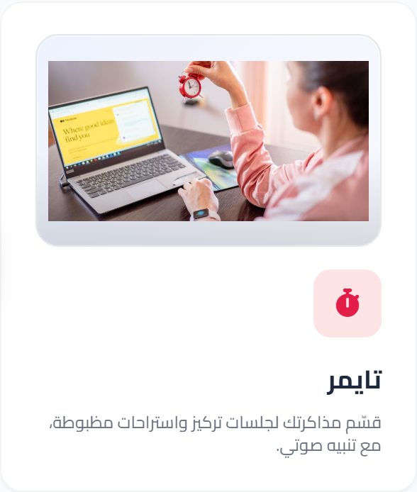

قسّم مذاكرتك لجلسات تركيز واستراحات مظبوطة.

- ثلاث حالات: تركيز، استراحة قصيرة، استراحة طويلة، وتغيّر مدة كل واحدة.
- تشغيل الجلسة اللي بعدها تلقائي.
- تكة صوتية في آخر ١٠ ثواني، وتنبيه من المتصفح، وتختار نغمة النهاية ومستوى الصوت.
- إعداداتك بتتحفظ.

---

### احسبلي كام %

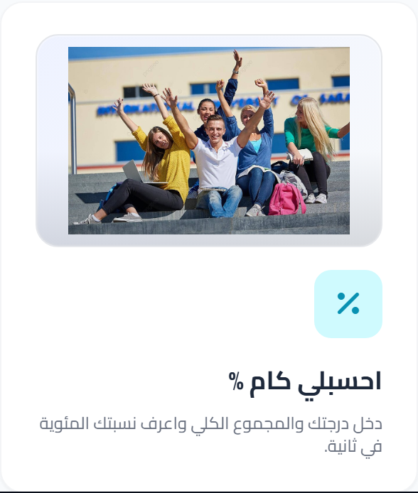

دخل درجتك والمجموع الكلي، وتعرف نسبتك المئوية في ثانية.

---

### آلة حاسبة علمية

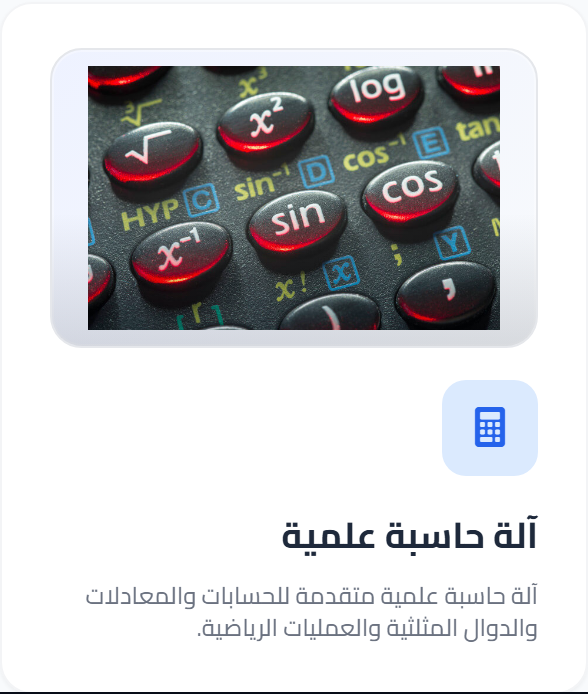

حاسبة متقدمة للمعادلات والكسور والجذور والقوى والمضروب والدوال المثلثية.

- اكتب المعادلة **بشكلها الرياضي الحقيقي** (كسر، جذر، أس).
- اختار الزوايا **درجات أو راديان**.
- **سجل العمليات** بيتحفظ وتقدر ترجعله وتنسخ أي نتيجة.

---

### ترجملي

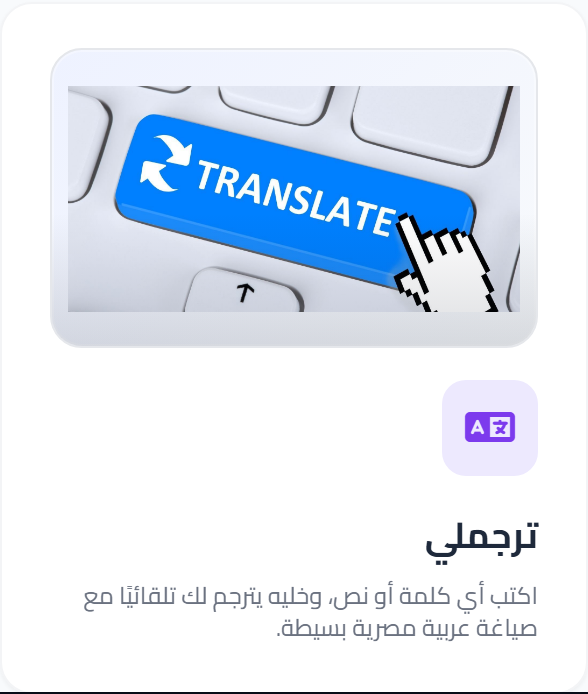

اكتب كلمة أو جملة أو نص كامل واختار اللغة.

- ترجمة بين **العربي والإنجليزي والفرنسي والألماني والإسباني والتركي**، مع اكتشاف تلقائي للغة.
- تحت الترجمة **صياغة مصرية أبسط** بنفس المعنى.

---

### مكتبتي

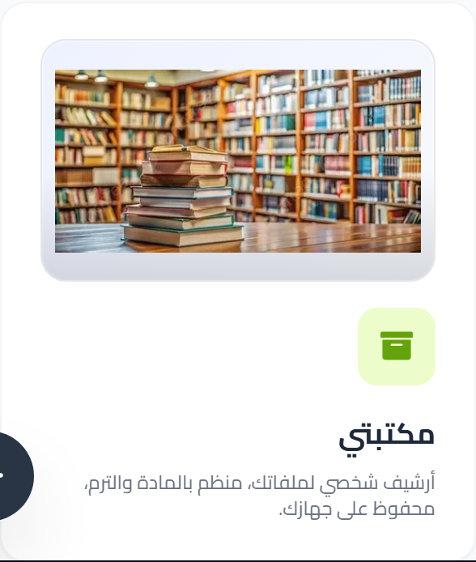

أرشيف شخصي لملفاتك، منظم بالمادة والترم.

- اسحب أي ملف أو اضغط وأضفه، وحدد المادة والترم.
- **الملفات محفوظة على جهازك بس**، مش على أي سيرفر.
- تجهيز أسئلة بمساعدة ChatGPT: تنسخ طلب جاهز، وتاخد ملف الأسئلة، وتستورده في الشيت أو الامتحان.

---

### قارئ صوتي

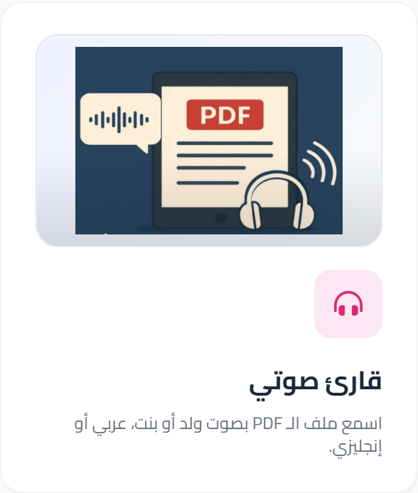

اسمع أي ملف PDF بدل ما تقراه.

- صوت **ولد أو بنت**، **عربي أو إنجليزي**.
- تضبط السرعة ودرجة الصوت، وتختار صوت معين من أصوات جهازك.

---

### تلوين PDF وتظليل

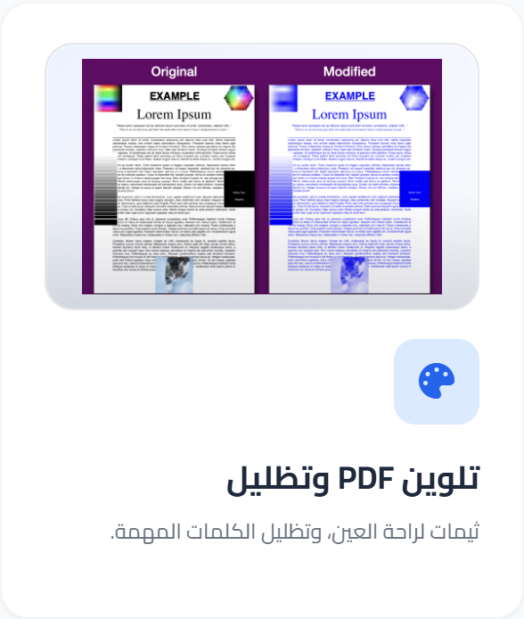

ثيمات تريّح عينك وانت بتذاكر، وتظليل للكلمات المهمة، وتقدر ترجّع أي صفحة للشكل الأصلي.

---

## 🧑‍🏫 للمعلم

### كشف الدرجات

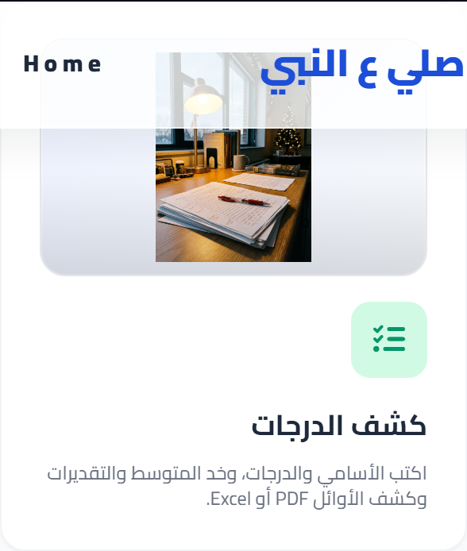

اكتب أسماء الطلاب ودرجاتهم والموقع يحسب كل حاجة.

- المتوسط والنسبة المئوية لكل طالب.
- التقدير (ممتاز، جيد جدًا...) ونسبة النجاح.
- ترتيب الطلاب وكشف الأوائل.
- تصدير الكشف **PDF** للطباعة أو **Excel**.

---

### شهادات التقدير

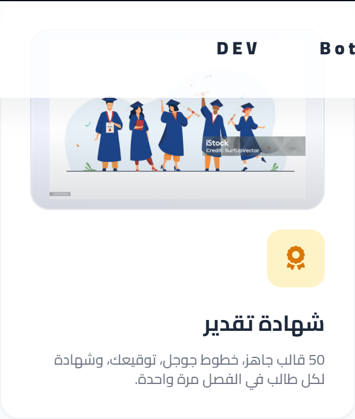

- **50 قالب جاهز** بإطارات مختلفة.
- خطوط جوجل عربي وإنجليزي.
- ضيف توقيعك (حتى لو صورة) وهيتنضف ويتحط على الشهادة، مع ختم وتاريخ.
- **شهادة لكل طالب في الفصل مرة واحدة** بدل ما تكتب كل اسم لوحده.

---

### الشيتات

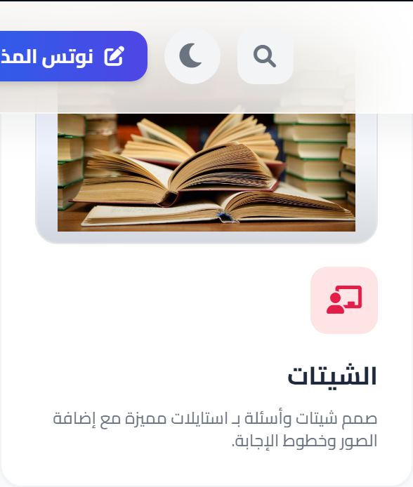

صمم شيتات وأسئلة بأستايلات مميزة مع صور وخطوط إجابة، وشوف التعديل **قدامك على طول**. وفي الآخر PDF للطباعة، أو تصدّر الأسئلة كملف للامتحان الأونلاين.

---

### القوالب

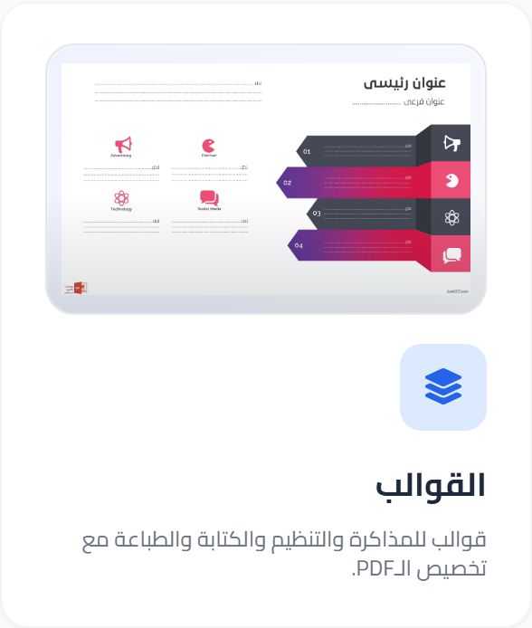

قوالب للمذاكرة والتنظيم والكتابة والطباعة، تختار وتعدّل المقاس والتفاصيل وتحمّل PDF.

---

### ملف الإجابات

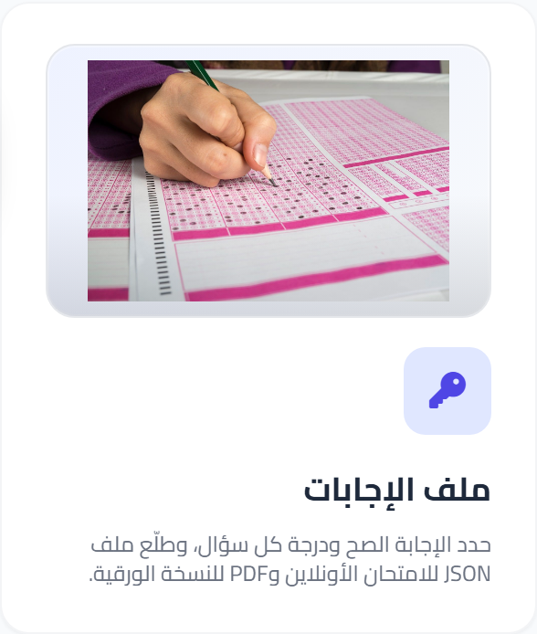

حدد الإجابة الصح ودرجة كل سؤال، وطلّع ملف للامتحان الأونلاين ونسخة PDF للامتحان الورقي.

---

### إنشاء امتحان أونلاين

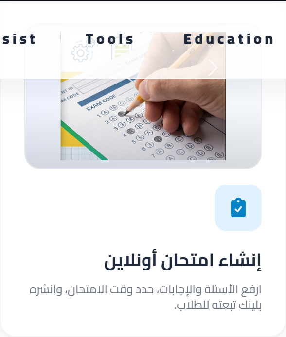

أقوى أداة للمدرس: امتحان لطلابك بلينك واحد.

- **ارفع** ملف الأسئلة وملف الإجابات، والموقع يتأكد إن العدد متطابق وإن كل إجابة صح ليها اختيار موجود.
- **حدد** اسم الامتحان، وقت البداية والنهاية، ومدة الحل.
- **انشر** وخد لينك ورسالة جاهزة تبعتها للطلاب بضغطة واتساب.
- الطالب بيدخل في أي وقت بين البداية والنهاية، وبيتقفل عليه لما مدته تخلص، وقبل البداية بيشوف **عدّاد تنازلي**.

---

### امتحانات طلابي ونتائجها

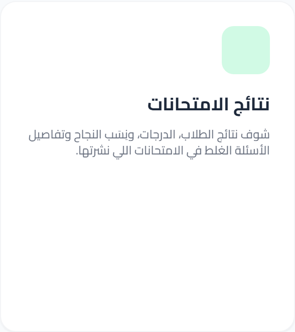

شوف كل الامتحانات اللي نشرتها، ونتيجة كل طالب، ونسب النجاح، والأسئلة اللي الطلاب غلطوا فيها أكتر، وتفاصيل إجابات كل طالب.

---

### تنظيف صور المحاضرات

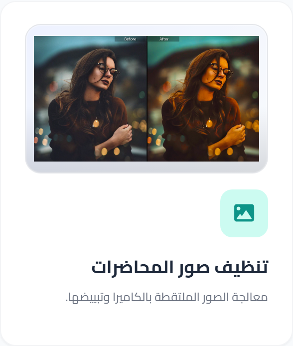

صوّرت المحاضرة بالكاميرا والصورة غامقة؟ الأداة بتبيّضها وتحسّنها لحد ما تبقى زي الملف المطبوع.

---

### مقارنة نسختين PDF

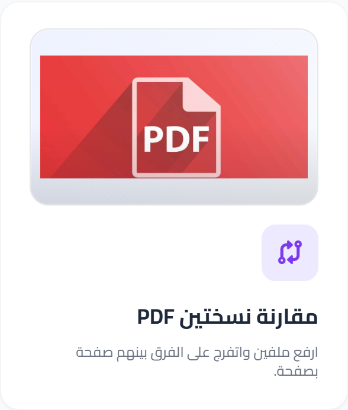

ارفع ملفين وشوف **الفرق بينهم صفحة بصفحة** مع تلوين لأي حاجة اتغيّرت.

---

## 📄 أدوات PDF

كل اللي محتاجه في ملفات الـ PDF، من غير ما ترفع حاجة لأي سيرفر.

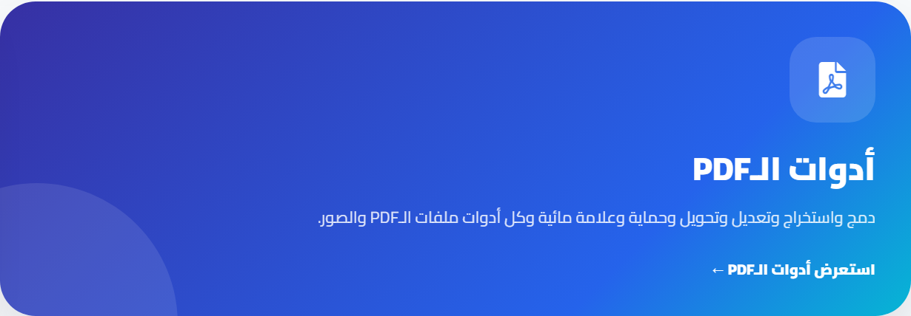

<table>
<tr>
<td align="center" valign="top" width="33%">
<a href="https://edu-11245.github.io/ETO-EDUCATION/#merge">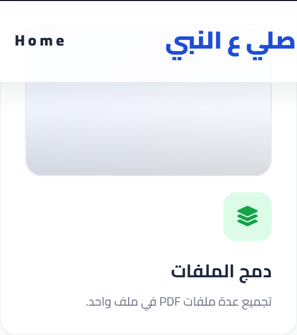</a> 
<b>دمج</b> 
تجمّع كذا ملف في واحد وترتّبهم بالسحب
</td>
<td align="center" valign="top" width="33%">
<a href="https://edu-11245.github.io/ETO-EDUCATION/#extract">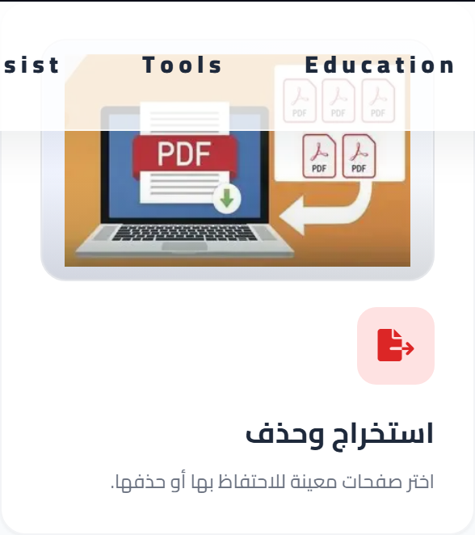</a> 
<b>استخراج وحذف</b> 
تختار صفحات تحتفظ بيها أو تمسحها
</td>
<td align="center" valign="top" width="33%">
<a href="https://edu-11245.github.io/ETO-EDUCATION/#editor">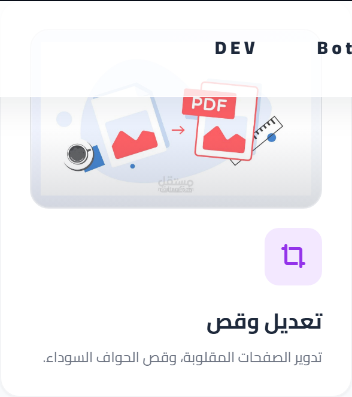</a> 
<b>تعديل وقص</b> 
تدوّر الصفحات المقلوبة وتقص الحواف السودا
</td>
</tr>
<tr>
<td align="center" valign="top" width="33%">
<a href="https://edu-11245.github.io/ETO-EDUCATION/#convert">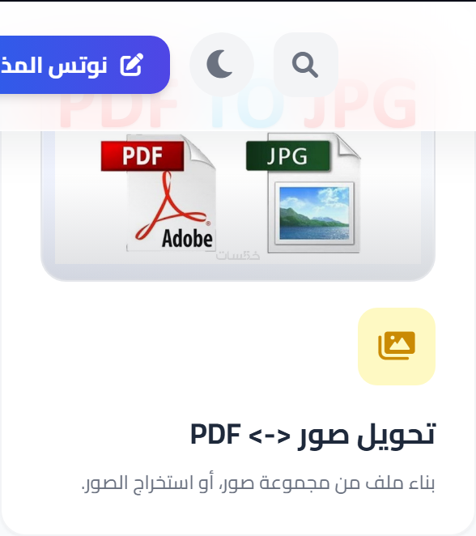</a> 
<b>صور وPDF</b> 
ابني ملف من صور، أو طلّع الصور، أو حوّل الصفحات لصور
</td>
<td align="center" valign="top" width="33%">
<a href="https://edu-11245.github.io/ETO-EDUCATION/#pdf-to-word">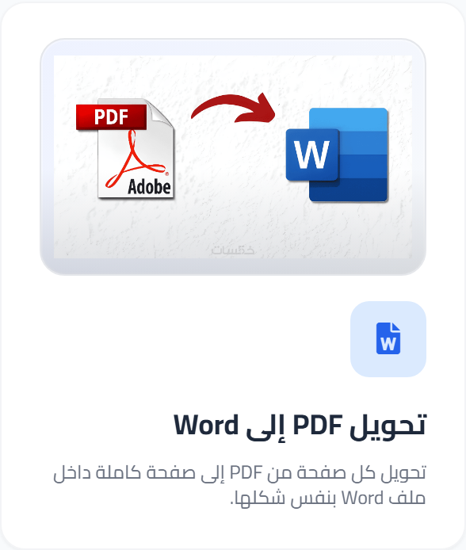</a> 
<b>PDF إلى Word</b> 
كل صفحة بنفس شكلها داخل ملف Word
</td>
<td align="center" valign="top" width="33%">
<a href="https://edu-11245.github.io/ETO-EDUCATION/#text">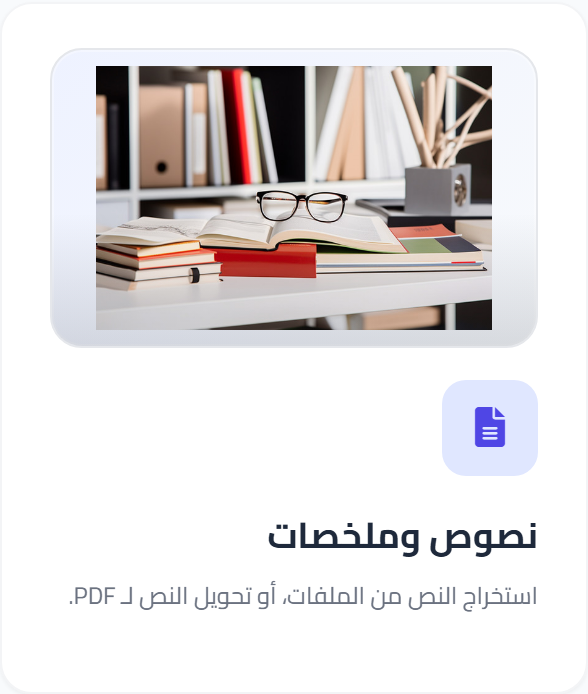</a> 
<b>نصوص وملخصات</b> 
طلّع النص من الملف (وبيقرا **العربي من الملفات الممسوحة**)
</td>
</tr>
<tr>
<td align="center" valign="top" width="33%">
<a href="https://edu-11245.github.io/ETO-EDUCATION/#watermark">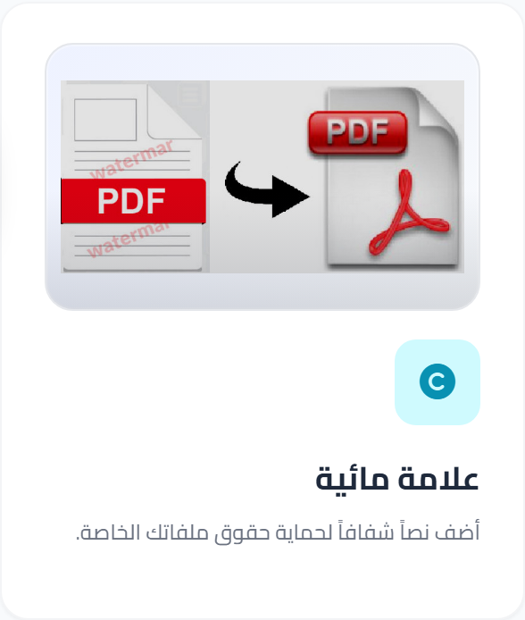</a> 
<b>علامة مائية</b> 
نص شفاف بيدعم العربي بحروف متصلة صح
</td>
<td align="center" valign="top" width="33%">
<a href="https://edu-11245.github.io/ETO-EDUCATION/#reorder">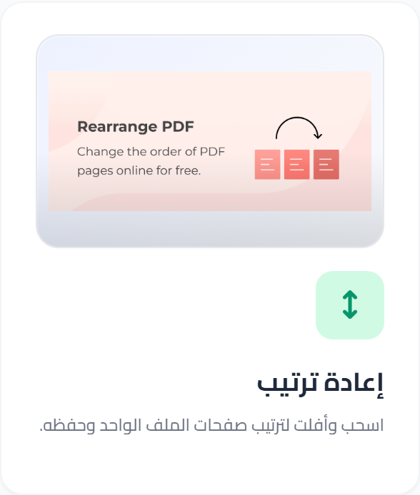</a> 
<b>إعادة ترتيب</b> 
اسحب وأفلت الصفحات وسجّل الترتيب
</td>
<td align="center" valign="top" width="33%">
<a href="https://edu-11245.github.io/ETO-EDUCATION/#protect">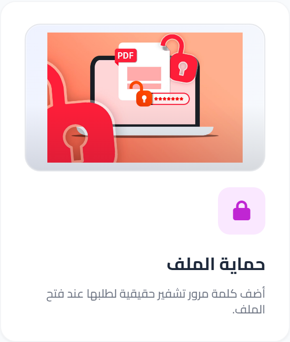</a> 
<b>حماية بكلمة مرور</b> 
تشفير حقيقي، والملف يطلب الباسورد عند فتحه
</td>
</tr>
<tr>
<td align="center" valign="top" width="33%">
 
<b>ضغط</b> 
صغّر حجم الملف
</td>
<td align="center" valign="top" width="33%">
<a href="https://edu-11245.github.io/ETO-EDUCATION/#ppt-pdf">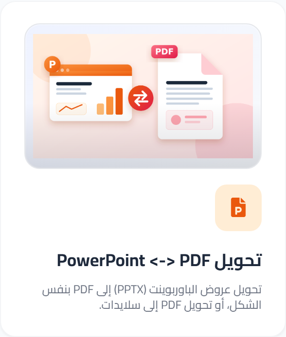</a> 
<b>PowerPoint و PDF</b> 
تحويل بين العروض وملفات PDF
</td>
</tr>
</table>

---

## 🎧 أدوات الصوت

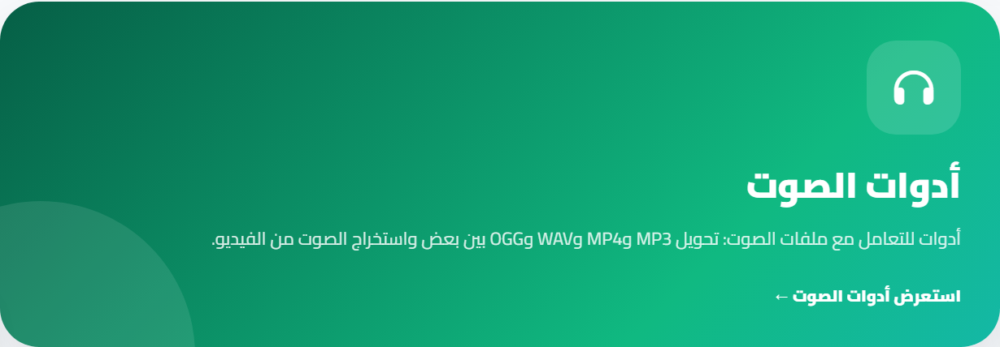

<table>
<tr>
<td align="center" valign="top" width="33%">
<a href="https://edu-11245.github.io/ETO-EDUCATION/#mp3-to-mp4">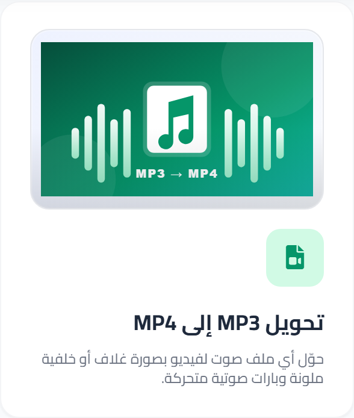</a> 
<b>MP3 إلى MP4</b> 
حوّل الصوت لفيديو بصورة غلاف أو خلفية ملونة وبارات صوتية متحركة
</td>
<td align="center" valign="top" width="33%">
<a href="https://edu-11245.github.io/ETO-EDUCATION/#mp4-to-mp3">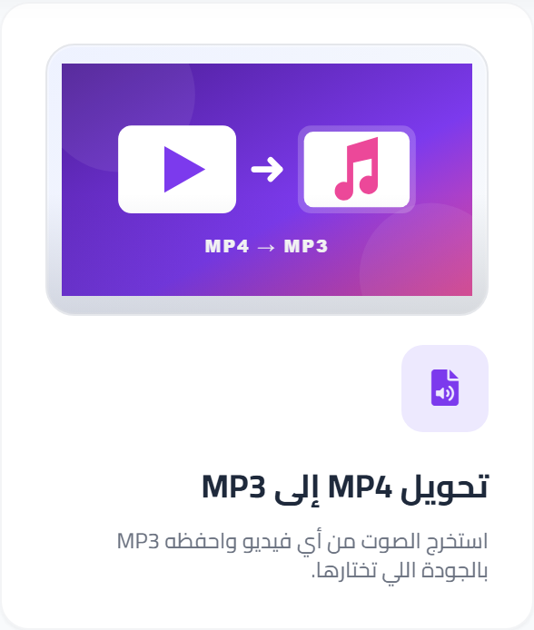</a> 
<b>MP4 إلى MP3</b> 
طلّع الصوت من أي فيديو بالجودة اللي تختارها
</td>
<td align="center" valign="top" width="33%">
<a href="https://edu-11245.github.io/ETO-EDUCATION/#mp3-to-wav">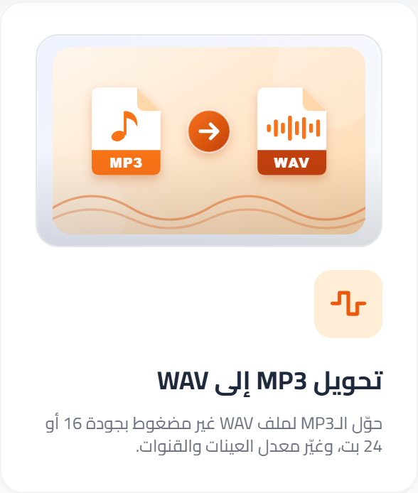</a> 
<b>MP3 إلى WAV</b> 
ملف غير مضغوط بجودة 16 أو 24 بت
</td>
</tr>
<tr>
<td align="center" valign="top" width="33%">
<a href="https://edu-11245.github.io/ETO-EDUCATION/#wav-to-mp3">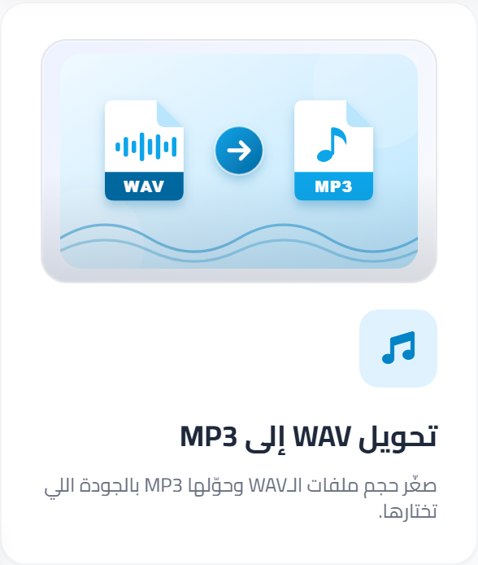</a> 
<b>WAV إلى MP3</b> 
صغّر حجم ملفات الـ WAV
</td>
<td align="center" valign="top" width="33%">
<a href="https://edu-11245.github.io/ETO-EDUCATION/#mp3-to-ogg">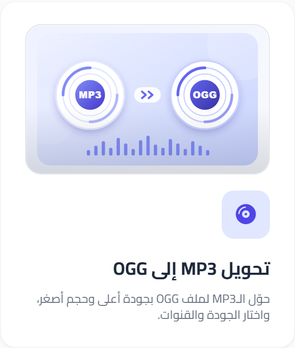</a> 
<b>MP3 إلى OGG</b> 
جودة أعلى وحجم أصغر
</td>
<td align="center" valign="top" width="33%">
<a href="https://edu-11245.github.io/ETO-EDUCATION/#ogg-to-mp3">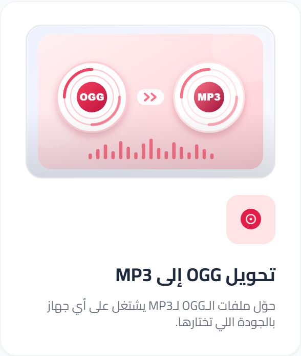</a> 
<b>OGG إلى MP3</b> 
يشتغل على أي جهاز
</td>
</tr>
</table>

---

## 🔬 أدوات تعليمية تفاعلية

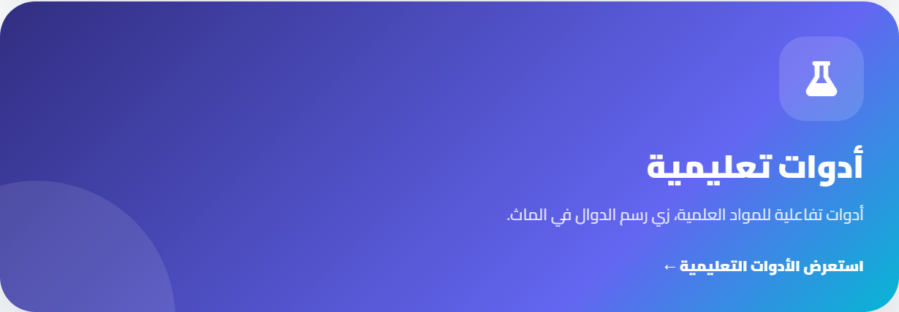

### رسم الدوال (Maths 1)
اكتب أي دالة وشوفها بتترسم، مع **تكبير وتحريك** وقراءة قيم النقط على الرسم.

### الجدول الدوري
جدول تفاعلي لـ **118 عنصر** مع بحث وفلترة وتفاصيل كل عنصر.

### Bio Labs (معمل العملي)
**60 عينة** في **7 لابات** (الخلايا، الميكروسكوب، العضيات، النواة والانقسام، الأجنة، الأوليات، اللافقاريات): صور ورسومات من محاضراتك، الاسم بالعربي والإنجليزي والعلمي، أجزاء مسمّاة ودليل فهم للامتحان العملي، ومشاركة أي عينة بلينك بيظهر باسمها وصورتها.

---

## 📚 المواد الدراسية وتعلّم اللغات

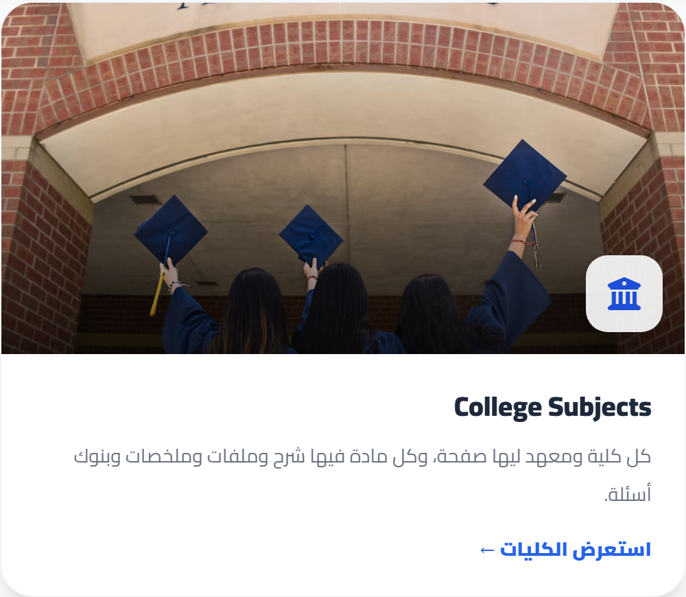

صفحة لكل كلية ومعهد، وكل مادة فيها شرح وملفات وملخصات، وتفتح الملفات **جوه الموقع** من غير تحميل.

كورسات لغات خطوة بخطوة، كل كورس مقسّم لوحدات ودروس، وواجهة الصفحات بتدعم الإسباني والفرنسي والألماني.

---

## 🕌 الركن الديني

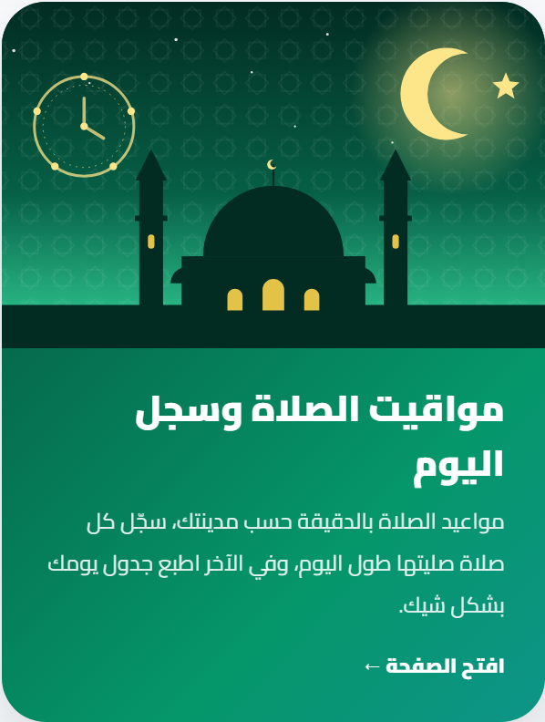

### مواقيت الصلاة وسجل اليوم

- مواعيد الصلاة حسب مدينتك (٢٤ مدينة أو موقعك الحالي) بحساب الهيئة المصرية العامة للمساحة.
- **عدّاد تنازلي** للصلاة الجاية وحلقة بتتملي مع كل صلاة بتصليها.
- سجّل كل صلاة: **في وقتها / جماعة / قضاء / فاتتني**، والعبادات الإضافية (السنن، الوتر، الضحى، الأذكار، ورد القرآن، الصدقة).
- إحصائية آخر ٧ أيام وعدد الأيام المتتالية.
- **اطبع جدول يومك** أو جدول فاضي تكتبه بإيدك (PDF بتصميم شيك).
- سجلّك محفوظ على جهازك بس.

 

---

## 🤖 روبوت إيتو

روبوت صغير **بيمشي فوق الصفحة** وبيعرّفك على الموقع.

- اسأله عن أي أداة وهو يوصّلك لها.
- محادثته بتتفتح في شاشة كاملة.
- بيختفي لوحده في صفحات الأدوات عشان ما يشتتكش.

---

## ✨ أحسن حاجات في الموقع

<table>
<tr>
<td width="50%" valign="top">

### 🔒 خصوصيتك محترمة
ملفات الـ PDF والصوت بتتعالج **على جهازك**. ومكتبتك الشخصية محفوظة عندك بس.

</td>
<td width="50%" valign="top">

### 🇪🇬 مصري وبسيط
الشرح بالعامية المصرية، والأدوات متقسمة بوضوح، والبحث الشامل بيوصّلك لأي حاجة في ثانية.

</td>
</tr>
<tr>
<td width="50%" valign="top">

### 📱 يشتغل على أي جهاز
موبايل وتابلت وكمبيوتر، ووضع فاتح وداكن.

</td>
<td width="50%" valign="top">

### ⚡ مفيش تسجيل للأدوات
افتح الأداة واشتغل علطول. التسجيل بجوجل مطلوب بس للمدرس اللي هينشر امتحان.

</td>
</tr>
</table>

---

## 📲 ثبّت الموقع كتطبيق

مش محتاج متجر تطبيقات.

| الجهاز | الخطوات |
|---|---|
| **أندرويد / كمبيوتر (كروم وإيدج)** | اضغط زرار **تحميل التطبيق** اللي بيظهر في الموقع، أو من قايمة المتصفح اختار **تثبيت** |
| **آيفون (سفاري)** | اضغط **مشاركة** ثم **إضافة إلى الشاشة الرئيسية** |

وهيبقى ليه أيقونة على موبايلك وبيفتح ملء الشاشة زي أي تطبيق.

---

## ❓ أسئلة شائعة

<b>هل الموقع مجاني فعلًا؟</b>

أيوه، كل الأدوات مجانية ومن غير اشتراك.

<b>ملفاتي بتتبعت لسيرفر؟</b>

لأ. أدوات الـ PDF والصوت والصور بتشتغل على جهازك. الاستثناء الوحيد هو الترجمة (النص اللي بتكتبه بيتبعت لخدمة الترجمة) والامتحانات الأونلاين (الأسئلة والنتائج بتتخزن عشان الطلاب يحلّوا).

<b>محتاج حساب عشان أستخدم الأدوات؟</b>

لأ. التسجيل بحساب جوجل مطلوب **للمدرس بس** لما ينشر امتحان أونلاين.

<b>الطالب بيحتاج تسجيل عشان يحل الامتحان؟</b>

لأ. بيفتح اللينك، ويكتب اسمه ورقمه، ويبدأ. وبعد التسليم بيشوف نتيجته، ومبيقدرش يحل نفس الامتحان تاني من نفس الجهاز.

<b>مكتبتي اختفت؟</b>

المكتبة محفوظة في متصفحك على الجهاز ده بس. لو مسحت بيانات الموقع أو غيّرت المتصفح أو الجهاز مش هتلاقيها، فاحتفظ بنسخة من الملفات المهمة.

<b>إزاي أبعت ملخص يتنشر؟</b>

من صفحة الملخصات اضغط **إضافة ملخص**، واكتب بياناتك واسم الدرس، ووافق على الشروط، وهيفتحلك واتساب برسالة جاهزة. ابعتها وارفق الملف. بعد المراجعة بيظهر للكل.

<b>الصوت العربي في القارئ مش شغال</b>

القارئ بيستخدم الأصوات المثبّتة على جهازك. لو مفيش صوت عربي، ثبّته من إعدادات الجهاز (اللغة والصوت) وجرّب تاني.

<b>أقدر أستخدم الموقع بدون إنترنت؟</b>

الموقع بيتثبّت كتطبيق وبيحتفظ بجزء من الصفحات، لكن أغلب الأدوات والمحتوى محتاجة إنترنت أول مرة. بعد التثبيت بيبقى أسرع في الفتح.

---

## 🎯 الموقع مناسب لمين؟

| لو انت | هتستفيد من |
|---|---|
| **طالب ثانوي أو جامعة** | الملخصات والامتحانات، جدولي، التايمر، الحاسبة العلمية، القارئ الصوتي، مكتبتي، المواد الدراسية |
| **مدرس** | الامتحانات الأونلاين، كشف الدرجات، الشهادات، الشيتات، ملف الإجابات، مقارنة الملفات |
| **بتتعامل مع ملفات كتير** | دمج وتقسيم وضغط وتحويل وحماية الـ PDF، وتحويلات الصوت |
| **بتتعلم لغة** | كورسات اللغات والترجمة والقارئ الصوتي |
| **دارس علوم** | الجدول الدوري ورسم الدوال وBio Labs |
| **عايز تنظم صلواتك** | مواقيت الصلاة وسجل اليوم |

---

## 🔗 كل اللينكات

**🎒 للطالب**

           

**🧑‍🏫 للمعلم**

        

**📄 أدوات PDF**

          

**🎧 أدوات الصوت**

     

**🔬 أخرى**

   

---

## 💬 تواصل

لو عندك اقتراح أداة جديدة أو لقيت مشكلة، افتح **Issue** هنا على GitHub وهنشوفها.

---

  <b>المؤسس والمطوّر</b> 
  <b>Mohammed Saad</b>

<i>صل ع النبي. بالتوفيق يارب.</i>

